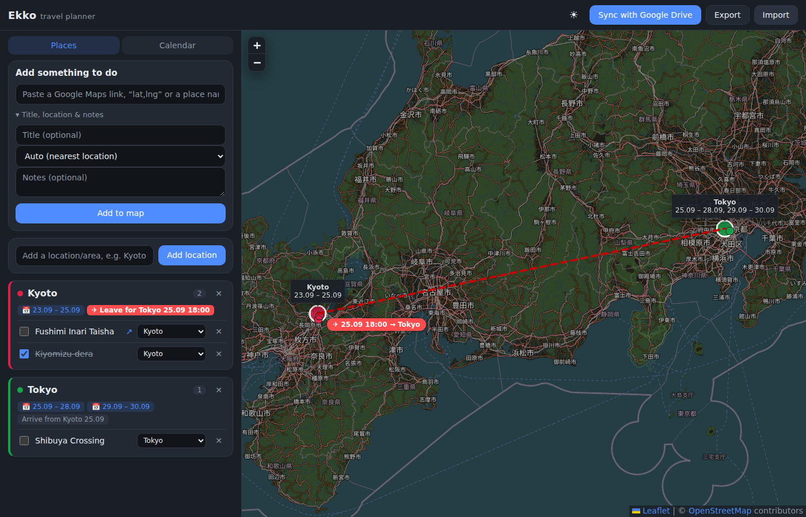
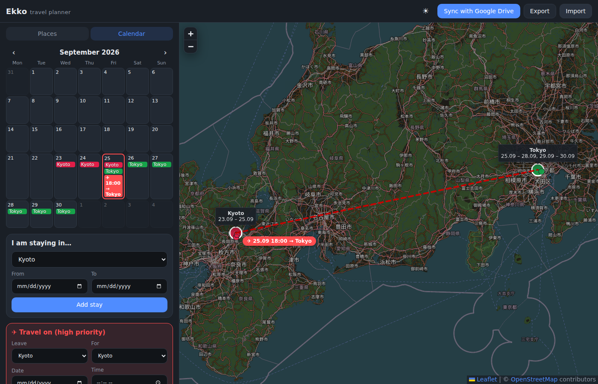
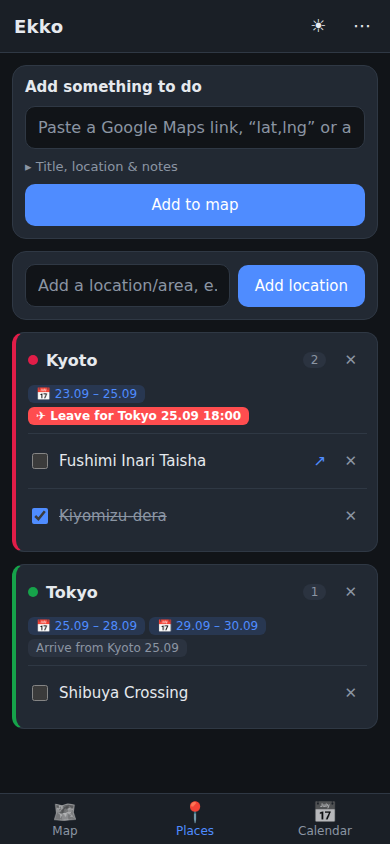
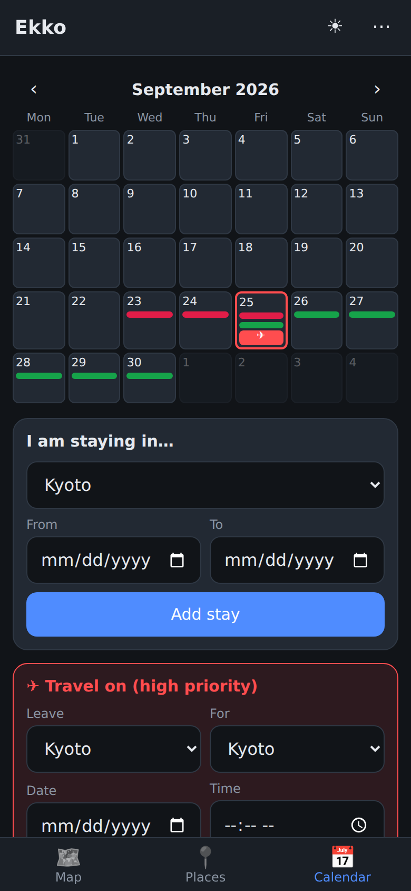
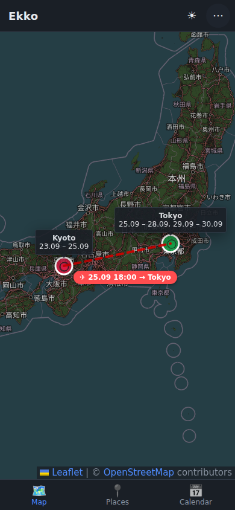
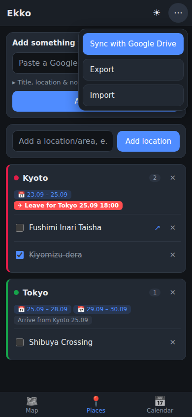

# ekko-travel-planer

MVP of an interactive map with a calendar that lets you plan vacations/trips.

Ekko is a static website – there is **no backend**. Your trip is stored in your browser and can
optionally be synced through **your own Google Drive**.

## Screenshots

Dark mode is the default (☀ switches to light mode).

**Desktop**

 

**Mobile**

   

## Features

- **Put things you want to do on a map.** Paste a Google Maps link (e.g.
  `https://www.google.com/maps/place/Fushimi+Inari+Taisha/@34.96,135.77,17z/...`), plain
  coordinates (`35.0116,135.7681`) or a place name. Coordinates are read straight from the link;
  names are looked up with OpenStreetMap Nominatim. Short links (`maps.app.goo.gl/...`) cannot be
  expanded without a server, so you are asked to click the spot on the map instead – the link is
  still saved on the item.
- **Items are organised by location, not by date.** Add locations/areas (Kyoto, Tokyo, …); new
  items are automatically linked to the nearest location (within 75 km) and can be moved to another
  location at any time. Locations are listed in the order you visit them.
- **Calendar.** Plan when you are in which location (e.g. Kyoto 23.09 – 25.09, Tokyo 25.09 – 28.09).
- **High-priority "travel on" markers.** Add a departure such as *leave Kyoto for Tokyo on 25.09 at
  18:00*. It is shown clearly in red: on the calendar day, next to the location in the list, and
  as a dashed route with a label on the map. When two locations share a day without such a marker
  (or a marker does not match the stays) a warning is shown.
- **Sync & backup.** Everything is saved in `localStorage`. Use *Export* / *Import* for JSON
  backups, or *Sync with Google Drive* to keep the trip in your Drive (`ekko-trip.json`) and use it
  from several devices.
- **Dark by default, mobile friendly.** Toggle light/dark with ☀/☾ (remembered per browser). On
  small screens the app switches to full-screen *Map / Places / Calendar* views with a bottom tab
  bar; Drive/Export/Import move into the ⋯ menu and optional fields are collapsed.

## Running it

Any static file server works, e.g.

```sh
npm start            # = python3 -m http.server 8080
# open http://localhost:8080
```

(Opening `index.html` directly from disk does not work because browsers block ES modules on
`file://`.) To publish it, serve the repository with GitHub Pages or any other static host.

## GitHub Pages

The site is published at <https://johnew.github.io/ekko-travel-planer/> when the `main` branch is
updated. To enable publishing, set **Settings → Pages → Build and deployment → Source** to
**GitHub Actions**. The `Publish to GitHub Pages` workflow also supports manual runs from the
Actions tab.

## Google Drive sync

Sync uses [Google Identity Services](https://developers.google.com/identity/oauth2/web/guides/use-token-model)
in the browser and calls the Drive REST API directly, with the `drive.file` scope (the app can only
see files it created). You need an OAuth client ID once:

1. In the [Google Cloud console](https://console.cloud.google.com/) create a project and enable the
   **Google Drive API**.
2. Configure the OAuth consent screen and create an **OAuth client ID** of type *Web application*.
3. Add the URL you serve Ekko from (e.g. `http://localhost:8080` or `https://<user>.github.io`) to
   **Authorized JavaScript origins**.
4. Either set `googleClientId` in the `EKKO_CONFIG` block in `index.html`, or paste the client ID
   when you click *Sync with Google Drive* (it is remembered in the browser).

When connecting, the newer of the local trip and the Drive copy wins; after that every change is
saved to Drive automatically.

## Development

- `index.html`, `styles.css` – page layout
- `src/model.js` – pure logic (link parsing, grouping by location, calendar, warnings)
- `src/app.js` – UI and map ([Leaflet](https://leafletjs.com/), vendored in `vendor/leaflet`)
- `src/storage.js` – localStorage and JSON import/export
- `src/drive.js` – Google Drive sync

Run the unit tests (Node.js 18+, no dependencies):

```sh
npm test
```
